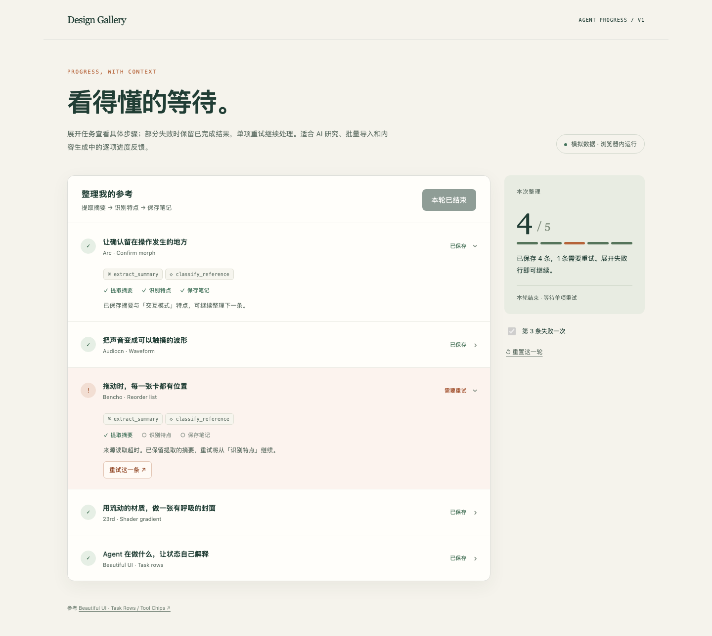

# 任务进度

Web / 动效与反馈

[体验](../index.html#/web/topic/agent-progress?case=agent-progress)

逐项整理五条模拟参考，将当前阶段、完成与中断放在各自条目附近。展开后查看阶段细节，失败项可单独重试，也可切换顺畅情境，适合批量导入与内容整理中的进度反馈。

收录 2026-10-15 · v1 · [参考 Beautiful UI](https://beautifului.dev/)
