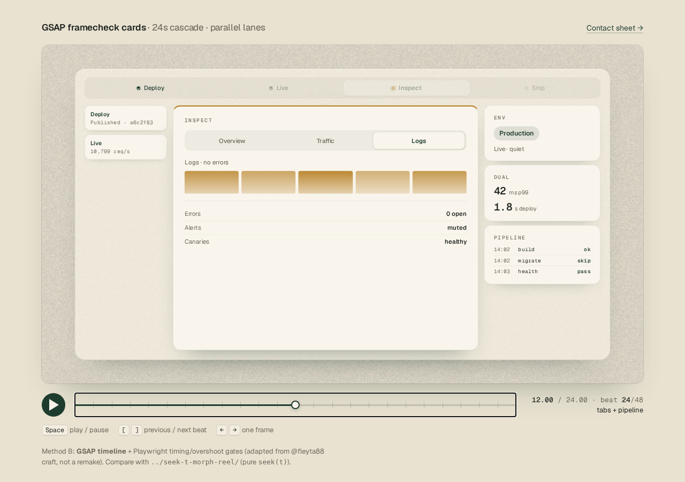
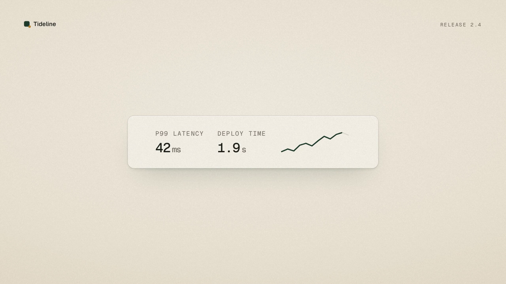

# 把发布信息变成短片

视频 / 界面与信息

## 卡片级联

[体验此案例](../index.html#/video/topic/product-launch?case=gsap-framecheck-cards)

同一条虚构的「安静发布」故事，以焦点卡、回执条和卫星信息的交错出现组织阅读顺序。暖纸、绿与赭石保持统一气质，时间轴可拖动并逐帧查看，适合观察信息分组、出现节奏和画面留白。

收录 2026-10-20 · v1 · [参考 设计实验室](../assets/gsap-framecheck-cards/v1/index.html)

## 连续变形

[体验此案例](../index.html#/video/topic/product-launch?case=seek-t-morph-reel)

虚构的 Tideline 2.4 发布信息沿同一物件连续变化：发布按钮变成进度环与完成标记，再交给数据与回执卡片。可播放、暂停、拖动时间轴和逐帧查看，适合观察连续形变怎样连接一段产品叙事。

收录 2026-10-20 · v1 · [参考 设计实验室](../assets/seek-t-morph-reel/v1/index.html)
