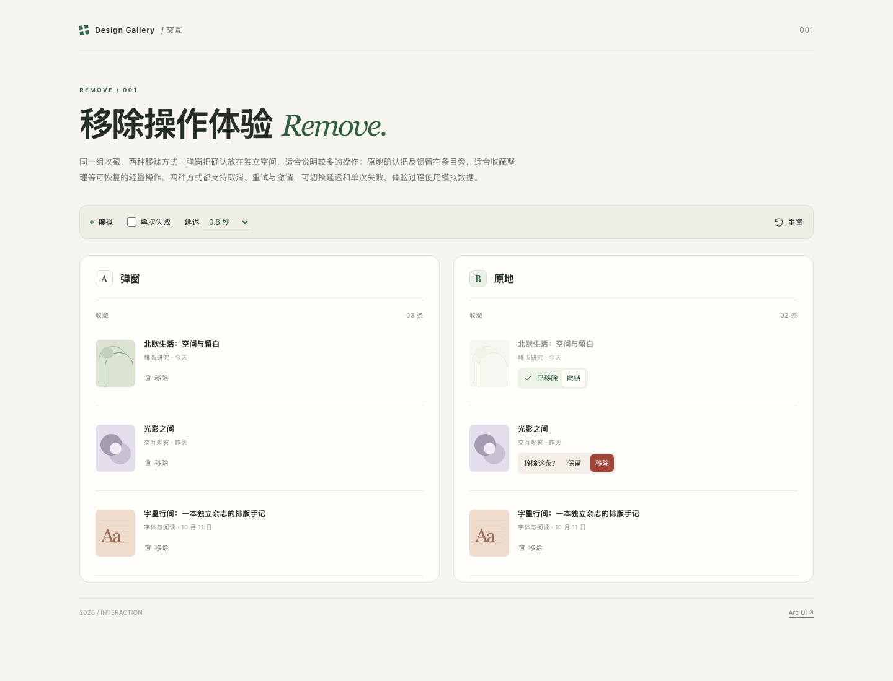

# 移除操作体验

[体验](../assets/remove-experience/v2/index.html)

同一组收藏，两种移除方式：弹窗把确认放在独立空间，适合说明较多的操作；原地确认把反馈留在条目旁，适合收藏整理等可恢复的轻量操作。两种方式都支持取消、重试与撤销，可切换延迟和单次失败，体验过程使用模拟数据。交互参考 [Arc UI 的 Confirm morph](https://uiarc.dev/components/confirm-morph)，页面代码与图形由 huggon1 与 borkwuddy 的设计实验室独立制作。
