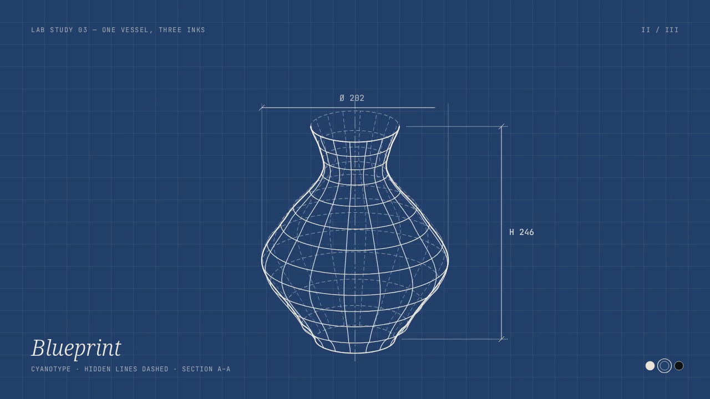

# 三种墨水线稿

视频 / 图形与材质

[体验](../index.html#/video/topic/three-ink-linework?case=three-ink-linework)

同一只器皿沿着同一段几何运动，依次呈现纸上铅笔、蓝图和发光线稿。画法改变时保留物件的连续性，适合观察线条、材质与显现节奏，也可作为品牌线稿短片的参考。

收录 2026-10-20 · v1 · [参考 设计实验室](../assets/three-ink-linework/v1/index.html)
